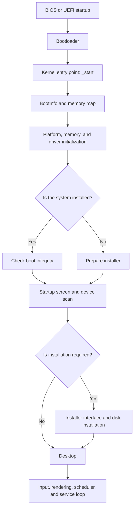

# NetizenCore Kernel


NetizenCore Kernel is the Rust-based x86_64 bare-metal kernel developed for the NetizenCore operating system. It runs without depending on Rust's standard library (`std`) and coordinates the early system startup, memory setup, graphics, input devices, storage, task scheduling, and system-service initialization.

The project targets a shared kernel structure with a BIOS-based boot flow, an optional UEFI component, and multiple platform profiles. The QEMU profile supports development and testing in a virtual machine, while the `generic` profile selects a separate platform backend.

> This repository is under active development. The descriptions below reflect functionality present in the source code or explicitly connected by the kernel. The existence of an interface does not imply complete support on every physical device or an independently audited security guarantee.

## Table of Contents

- [Features](#features)
- [Architecture](#architecture)
- [Boot and Runtime Flow](#boot-and-runtime-flow)
- [Security Model](#security-model)
- [Project Structure](#project-structure)
- [Requirements](#requirements)
- [Build and Run](#build-and-run)
- [Current Limitations](#current-limitations)
- [License](#license)

## Features

| Area | Functionality | Notes |
|---|---|---|
| Kernel foundation | `no_std`, `no_main`, x86_64 entry point | Uses custom entry code and a linker script. |
| Platform selection | `qemu` and `generic` features | Select exactly one platform profile per build. |
| Memory management | Boot information and memory-map checks; arena and locked heap allocators | Includes bounds checks for memory ranges and size calculations. |
| Graphics | Framebuffer drawing, canvas composition, and regional screen updates | Supports updating changed rectangular regions as well as full-screen output. |
| Startup interface | Boot animation and setup-preparation screen | Startup subtitles vary depending on setup state. |
| Installation | Disk selection, initial language and keyboard-layout selection, and system installation flow | Chooses a legacy BIOS or UEFI path based on the detected boot environment. |
| Storage devices | Block-device abstraction and disk registry | Scans four ATA channels during preparation and reads partition information. |
| Input devices | Input-device interface and PS/2 input integration | Keyboard input and mouse state are combined through a shared manager. |
| Task management | Kernel-task state tracking, context switching, sleep, and yield mechanisms | The scheduler uses context-switching support from `nc-arch`. |
| Task stack checks | Stack-overflow detection using a task stack canary | A failed check enters the kernel panic path. |
| Permission policy | Trust levels, capability bit masks, and a default-deny approach | Built-in applications have distinct permission sets. |
| Boot integrity | Integrity-check invocation during startup of an installed system | Startup halts if the check fails; verification is delegated to `nc-storage`. |
| Network services | Network-stack initialization and a periodic polling task | Supported protocols and hardware depend on the relevant network and platform modules. |
| Error handling | Panic reporting to the serial port and safe halt | Interrupts are disabled and the kernel halts during panic handling. |

## Architecture

The kernel separates hardware and system subsystems into modules. The platform is selected at compile time, while graphics, storage, networking, input, and desktop functionality are handled by their respective crates.



### Platform Profiles

| Profile | Build feature | Purpose |
|---|---|---|
| QEMU | `qemu` | Development and testing in a virtual machine |
| Generic | `generic` | A separate build profile that selects the generic platform backend |

`kernel/src/platform.rs` produces a compile-time error if both profiles are selected or if neither is selected.

### Graphics and User Interface

The kernel obtains framebuffer information from boot data and renders the interface using multiple canvases. At startup, it displays a boot animation; if the system is not installed, it transitions to the installer, otherwise it proceeds to the desktop.

In addition to full-screen presentation, the renderer can update only changed regions. The desktop transition uses canvas composition and a timed frame loop.

### Memory Management

The kernel examines the memory regions supplied by the bootloader, validates available memory, and reserves space for an arena and the global heap.

Canvas creation checks for zero dimensions, excessive dimensions, and multiplication overflow before allocating memory. These checks are intended to prevent invalid sizes from reaching allocation routines.

### Devices and Scheduling

Block devices are registered through the `BlockDevice` interface, while input devices use `InputDevice`. This lets the kernel manage devices through shared interfaces rather than binding every operation directly to one concrete implementation.

The task manager tracks task states, scheduler ticks, and stack canaries. A network polling task periodically processes the network stack, and a separate kernel task is defined for storage monitoring.

## Boot and Runtime Flow

1. The platform backend is created and initialized.
2. Boot information and the available-memory map are read, and memory allocation is prepared.
3. The architecture's interrupt infrastructure and driver registry are initialized.
4. If an installed system is detected, a boot-integrity check is invoked through `nc-storage`. The kernel does not continue if the check fails.
5. While the startup screen is displayed, disk channels are scanned, partition information and saved language/keyboard settings are read, and the network stack is polled.
6. If installation is required, the user selects a disk and initial settings; otherwise, the desktop is started.
7. The desktop loop processes input, updates changed screen regions, and runs the task manager.

## Security Model

The kernel includes a permission and policy layer referred to as **DysonSphere**. Application identities carry a trust level and a capability mask. The source defines categories including:

| Permission group | Scope |
|---|---|
| Settings | Read settings; change display, language, network, and driver settings |
| User files | Read, write, and delete user files |
| Package operations | Package-installation permission |
| Networking | Permission to use client networking |
| Kernel-internal | Internal capability mask for kernel services |

Built-in applications such as `nc.settings`, `nc.files`, and `nc.browser` are assigned different permissions according to their application identities. Permission masks are restricted for verified third-party applications, while unverified legacy packages do not receive privileges by default. An integrity check is also invoked during startup of an installed system.

> **Security scope:** These mechanisms demonstrate a kernel-side permission model and associated control points. This README does not claim complete user-mode (Ring 3) process isolation, exhaustive authorization checks for every resource, independently verified cryptographic implementations, or a completed security audit. Package verification and boot-seal details depend on the actual implementations in the relevant subsystems.

## Project Structure

The following files were present in the inspected kernel archive:

| File | Responsibility |
|---|---|
| `kernel/src/main.rs` | Kernel initialization, memory setup, graphics loop, installer/desktop transition, and panic handler |
| `kernel/src/entry.rs` | `_start` entry point, initial stack, and BSS clearing |
| `kernel/src/platform.rs` | Selects the platform backend based on build features |
| `kernel/src/devices.rs` | Registers block and input devices and combines input |
| `kernel/src/prepare.rs` | Startup disk scan, localization loading, and network-stack polling |
| `kernel/src/process.rs` | Kernel tasks, scheduling, task state, and capability-based identities |
| `kernel/linker.ld` | Kernel layout, entry section, BSS, and initial stack |
| `kernel/build.rs` | Adds the linker script to the Rust link process |
| `build.sh` | Helpers for building the kernel/bootloader, creating an ISO, and launching QEMU or VirtualBox |

> A complete build also requires the `crates/nc-*` dependencies used by `nc-kernel` and the bootloader sources in the main repository. An archive containing only the `kernel/` directory is not sufficient to build the entire project.

## Requirements

The main build script uses the following tools:

- Rust and Cargo, including the `x86_64-unknown-none` target
- NASM
- `objcopy`, `llvm-objcopy`, or `rust-objcopy`
- `mkfs.vfat`, `mcopy`, and `mmd`
- `xorriso`, `genisoimage`, or `mkisofs` for ISO creation
- `qemu-system-x86_64` to run the QEMU build

The VirtualBox target additionally requires `VBoxManage`. Sources for all dependencies required by the selected platform profile must also be present in the working tree.

## Build and Run

Run these commands from the repository root:

```bash
# Build an ISO for the QEMU profile
bash build.sh qemu

# Build an ISO for the generic profile
bash build.sh generic

# Build and launch the QEMU profile
bash build.sh run

# Build both profiles
bash build.sh all

# Build and launch the generic profile in VirtualBox
bash build.sh vbox

# Generate the external generic display-driver example
bash build.sh drivers

# Remove build outputs
bash build.sh clean
```

The build script passes the selected profile to Cargo using `--features qemu` or `--features generic`, then combines the kernel binary with bootloader components to prepare an ISO. The UEFI binary is built optionally only if `crates/nc-uefi/Cargo.toml` exists in the repository.

## Current Limitations

- Hardware support depends on the selected platform backend and the actual coverage of its driver crates. The `generic` profile does not imply automatic support for every physical device.
- The scheduler provides context-switching infrastructure for kernel tasks. This README does not claim full virtual address-space support or Ring 3 isolation for general-purpose user processes.
- The complete network protocol scope cannot be established from the kernel files alone; consult `nc-net` and the platform drivers for details.
- Security and boot-integrity behavior must be evaluated alongside the implementations in `nc-storage`, the package manager, and other connected components.

## License

No license information was specified in the inspected kernel archive, so this README does not declare a license. Add an appropriate `LICENSE` file to the repository root and update this section to match the selected license before publishing.
