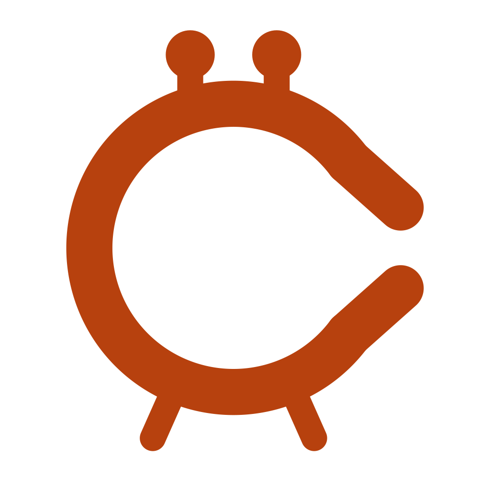

<div align="center">
  
  <h1>NetizenCore</h1>
  <p><strong>A bare-metal operating system project built with Rust, Assembly, and SPARK Ada.</strong></p>
  <p>
    <a href="https://github.com/Berkcan-1/NetizenCoreOS/actions/workflows/ci.yml"></a>
    
    
    
    
  </p>
  <p>
    <a href="#overview">Overview</a> ·
    <a href="#features">Features</a> ·
    <a href="#architecture">Architecture</a> ·
    <a href="#getting-started">Getting Started</a> ·
    <a href="#documentation">Documentation</a> ·
    <a href="#contributing">Contributing</a>
  </p>
</div>

---


## Overview

**NetizenCore** is an independent operating system project exploring a modular, security-oriented bare-metal system for desktop and ARM-based devices. It is developed primarily in **Rust (`no_std`)**, with low-level boot code in **Assembly** and a dedicated **SPARK Ada** security core.

The project brings together two development tracks:

- **x86_64:** a desktop-oriented system with BIOS and UEFI boot paths, a graphical desktop, built-in applications, and a modular kernel workspace.
- **AArch64 / ARMv8-A:** a mobile-oriented system path with an EL0 application environment, device profiles, Android-boot-image-compatible packaging, and QEMU `virt` support.

NetizenCore is not an Android distribution and does not aim to be a Linux distribution. Android image formats and partition metadata are used as part of the ARM device bring-up and packaging workflow; the system itself boots its own kernel and runtime.

> **Project status:** NetizenCore is an active experimental operating system project. Some subsystems are tested in QEMU, some have targeted unit tests, and others are still under development or blocked by missing hardware support. It is not yet a general-purpose, production-ready operating system. Check the [50-feature implementation matrix](docs/roadmap/NETIZENCORE_50_FEATURE_IMPLEMENTATION.md) before relying on a particular feature.

## Project at a Glance

| Area | Current direction |
|---|---|
| Kernel languages | Rust (`no_std`) and architecture-specific Assembly |
| Security core | SPARK Ada, exposed to Rust through a narrow C ABI |
| Application SDK languages | Rust, C, and C++ for supported AArch64 EL0 applications |
| Architectures | x86_64 and AArch64 / ARMv8-A; ARMv9-A build selection is also present |
| Boot paths | x86_64 BIOS and UEFI; AArch64 Linux Image-style kernel entry |
| Desktop environment | Custom framebuffer-based desktop, windows, taskbar, start menu, and built-in apps |
| Mobile environment | NetizenHome and mobile-oriented EL0 applications/UI components |
| Package format | `.ntzc` application packages |
| Main test environment | QEMU (`qemu-system-x86_64` and `qemu-system-aarch64`) |
| Build system | Cargo workspace plus shell/Python/Ada build tooling |

### Recorded verification snapshot

The repository's feature matrix records the following baseline for **November 21, 2026**. These are project-recorded results, not a claim that every feature or every physical device has been independently validated.

| Target / subsystem | Recorded result |
|---|---|
| ARM64 `qemu-virt` | 2,121,728-byte kernel `Image`; approximately 3.5-second QEMU boot; 33,280 / 33,280 PMM frames accounted for in the recorded test |
| x86_64 | 5,529,600-byte kernel in the recorded ISO build |
| SPARK Ada security core | 7 core units; 425 / 425 proof checks reported proved |
| SPARK known-answer tests | 35 / 35 tests reported passing |

See the [implementation matrix](docs/roadmap/NETIZENCORE_50_FEATURE_IMPLEMENTATION.md) and [SPARK proof report](spark/security/proofs/PROOF_REPORT.md) for scope and details.

---

## Features

The project is developed as a collection of cooperating subsystems rather than one monolithic source directory.

### Kernel and process infrastructure

- Separate x86_64 and AArch64 kernel implementations.
- Bare-metal startup, exception/interrupt handling, architecture abstractions, and memory management.
- User-mode execution paths: Ring 3 on x86_64 and EL0 on AArch64.
- System-call interfaces and a versioned public ABI.
- AArch64 priority-aware scheduling, SMP startup, and address-space support, with feature-specific verification documented in the roadmap.
- Kernel crash logging and debugging infrastructure.

### Memory and storage

- Physical memory management, arenas, heap allocation, paging, and architecture-specific page-table code.
- Copy-on-write and demand-allocation work in the AArch64 VM path.
- Shared-memory, futex, and compressed-memory components with targeted tests.
- Storage abstractions for block devices, partitions, and installation workflows.
- Filesystem components for FAT32, exFAT, EROFS, and in-memory filesystems.
- AArch64 `super.img` / logical-partition parsing and a writable QEMU `userdata` path.
- Work on metadata journaling, A/B slots, encryption, quotas, and safe USB storage handling.

### Graphics, desktop, and mobile UI


- Framebuffer rendering through a shared graphics layer and Canvas abstraction.
- Window and surface management, dirty-rectangle rendering, and a compositor path.
- Desktop shell components: wallpaper, desktop icons, taskbar, start menu, and window management.
- Setup and splash-screen interfaces.
- A separate mobile UI toolkit and NetizenHome application for AArch64.
- Fonts, image decoding, media handling, audio abstractions, and embedded visual assets.

### Built-in applications

The x86_64 application workspace currently includes the following application areas:

| Application | Purpose |
|---|---|
| Files | File navigation and `.ntzc` package installation |
| Settings | System settings |
| System | System information |
| Stopwatch | Stopwatch application |
| Browser | Custom browser application and JavaScript interpreter |

The AArch64 tree includes NetizenHome and EL0 application projects for Files and Settings. The `packages/mobile/` directory also contains `.ntzc` package artifacts for Files, Settings, Package Installer, Keyboard, Gallery, Messages, Phone, Contacts, and Camera. **The presence of an application source tree or package artifact does not mean that all of its hardware-dependent functionality is complete.**

### Browser and JavaScript engine

The browser project contains a custom HTML/CSS-oriented application layer and `nc-js`, a `no_std + alloc` tree-walking JavaScript interpreter. The interpreter implements a growing subset of the language, including functions, closures, classes, promises, timers, collections, regular expressions, and common built-ins.

It is not a fully standards-compliant browser engine. Known interpreter limitations include eager generator execution, blocking `async` / `await` behavior, no ES module support, and incomplete support for several modern JavaScript types and internationalization APIs. See [`apps/browser/nc-js/README.md`](apps/browser/nc-js/README.md) for the current compatibility notes.

### Networking

The `nc-net` service contains networking components for device networking, DHCP, DNS, TCP, TLS 1.3, and HTTP client functionality. The ARM64 roadmap records DNS/DHCP and TCP/IP integration work, while real Wi-Fi support and parts of the HTTPS/certificate path remain in progress. Bluetooth support is currently blocked in the roadmap. Do not assume that every network feature works on every target.

### Developer SDK and packages

- A Rust Ring 3 application SDK with syscall wrappers and graphics/application interfaces.
- A public, versioned ABI (currently documented as **v1.1.0**).
- `.ntzc` packages containing application metadata and executable payloads, with architecture and capability checks.
- A standalone **AArch64 C and C++ application SDK** for freestanding EL0 applications.
- Publisher-signing tools and package-generation scripts.

**C and C++ are application-SDK languages only.** The production kernel, SPARK security core, and production system images are intended to remain free of C/C++ application objects and `libstdc++`. The supplied C++ wrapper targets freestanding C++20 without exceptions or RTTI. See [`sdk/cc/README.md`](sdk/cc/README.md).

---

## Architecture

### High-level layers

The repository follows a dependency direction designed to keep hardware-specific code and application code separated:

```text
foundation
    ↓
hardware
    ↓
services
    ↓
graphics
    ↓
ui
    ↓
runtime
    ↓
apps
    ↓
kernel
```

A crate should depend only on its own layer and lower layers. Hardware-specific implementation belongs in the hardware layer; higher-level applications should use shared interfaces instead of directly depending on device internals.

| Layer | Main directory | Responsibilities |
|---|---|---|
| Foundation | `crates/foundation/` | HAL and ABI contracts, cryptography primitives, math, localization, compression, SPARK bridge |
| Hardware | `crates/hardware/` | CPU architecture abstractions, drivers, input, storage, platform profiles |
| Services | `crates/services/` | Memory services, VFS, networking |
| Graphics | `crates/graphics/` | Canvas, fonts, media decoding, assets, audio |
| UI | `crates/ui/` | Shared UI, application contracts, splash, setup, desktop shell |
| Runtime | `crates/runtime/` | Capabilities, ELF loading, package handling, app SDK/host, service facades |
| Applications | `apps/` and `aarch64crates/apps/` | Built-in application logic and user-mode entry binaries |
| Kernel | `kernel/` and `aarch64kernel/` | Boot orchestration, scheduling, system calls, address spaces, runtime integration |
| Bootloader | `bootloader/` | BIOS Assembly stages and x86_64 UEFI loader |

### Boot paths

#### x86_64

```text
BIOS                                      UEFI
  │                                         │
  ▼                                         ▼
El Torito stage 1 (NASM)                nc-uefi
  │                                         │
  ▼                                         ▼
stage 2 (NASM) ─────────────────────── BootInfo
  │                                         │
  └──────────────────────┬──────────────────┘
                         ▼
                  x86_64 kernel
                         │
              memory / devices / graphics
                         │
              setup wizard or desktop shell
```

The BIOS path uses a small Assembly boot chain; the UEFI path obtains the framebuffer and firmware memory map through the UEFI loader and passes a shared `BootInfo` contract to the kernel.

#### AArch64

```text
Firmware / device boot environment
               │
               ▼
       AArch64 Image entry
               │
          EL2 → EL1
               │
       DTB + MMU + memory
               │
       drivers / storage
               │
       EL0 application host
               │
       NetizenHome / UI
```

The AArch64 kernel parses a flattened device tree, initializes architecture and device services, and runs user applications at EL0. Device-specific information is kept in `aarch64crates/drivers/<device>/` profiles.

> **AArch64 PC note:** the `pc` build path currently produces a raw kernel `Image`. An AArch64 UEFI `BOOTAA64.EFI` loader is not present in this source snapshot.

### Ring 3 / EL0 application model

Applications are designed to run outside the kernel's most privileged execution level:

| Architecture | Kernel privilege | Application privilege | System-call instruction |
|---|---|---|---|
| x86_64 | Ring 0 | Ring 3 | `syscall` |
| AArch64 | EL1 | EL0 | `svc #0` |

The public ABI defines syscall conventions, fixed wire layouts, capability-aware service requests, and ABI discovery. Applications should use the SDK instead of relying on private kernel implementation details.

See [`docs/architecture/ABI_SPECIFICATION.md`](docs/architecture/ABI_SPECIFICATION.md) for the current ABI contract and [`kernel/SYSCALL_ABI.md`](kernel/SYSCALL_ABI.md) for the x86_64 kernel syscall interface.

---

## Security Model

NetizenCore separates general operating-system infrastructure from security policy decisions.

| Component | Primary responsibility |
|---|---|
| Rust kernel and services | Scheduling, memory management, traps, drivers, system calls, VFS/network services, and runtime integration |
| SPARK Ada security core | Capability policy, DysonSphere authorization, filesystem policy, process/IPC authorization, cryptographic routines, lock state, and data-encryption state |
| `nc-spark-sec` | Narrow Rust-to-SPARK C ABI adapter |
| `nc-pkg` / `nc-caps` | Package validation, publisher metadata, capability declarations, and effective application grants |

The SPARK security units use bounded data structures and explicit authorization decisions. The project records formal proof results for its seven core SPARK units and maintains known-answer/security-invariant tests.

**Formal verification has a defined boundary.** The recorded 425/425 proof result applies to the listed SPARK proof obligations; it does not formally prove the entire operating system. The project documentation explicitly identifies external trust boundaries, including Rust-side MMU and syscall framing, caller-identity authenticity, hardware entropy quality, Ed25519 verification, and compiler-level constant-time behavior. Review [`docs/architecture/SPARK_SECURITY.md`](docs/architecture/SPARK_SECURITY.md) and [`spark/security/proofs/PROOF_REPORT.md`](spark/security/proofs/PROOF_REPORT.md) before making security claims.

### Package capabilities

Applications declare capabilities in their package manifest. The kernel/runtime and SPARK policy layer determine which capabilities may actually be granted. User-installed packages are restricted to the user capability set; privileged operations are reserved for trusted system packages and must not be inferred from a manifest request alone.

Publisher signing keys are sensitive. The repository ignores local signing seeds under `sdk/keys/` and `*.seed`; **never commit a private publisher key**.

---

## Platform and Hardware Status

A device profile in the repository is not, by itself, proof of complete hardware support. The following table distinguishes the strongest recorded test path from profiles that still require device bring-up.

| Target / profile | Build path | Current confidence from repository notes |
|---|---|---|
| x86_64 QEMU | `x86_64 qemu` | Kernel/ISO build path and QEMU run workflow are present; recorded x86_64 build baseline exists |
| x86_64 generic PC | `x86_64 generic` | Generic platform profile exists; validate on the intended machine before use |
| AArch64 QEMU virt | `armv8a qemu` | Primary ARM64 development target; the roadmap records QEMU boot and SMP verification |
| Raspberry Pi 4 | `arm64 pc rpi4` / device profile | Device profile and driver crate exist; do not treat profile presence as full board validation |
| Infinix Hot 20 (X6826C / MT6768) | `armv8a android x6826c` | Device profile and Android-style image build path exist; physical hardware support remains incomplete/experimental |
| Other ARM devices | New device profile required | Not automatically supported; SoC, memory map, boot chain, storage, display, and input need device-specific work |

### Known hardware and feature limitations

The roadmap currently identifies work still needed in areas such as real Wi-Fi drivers, Bluetooth, GPU acceleration, power management, audio hardware, camera, modem/SIM, and sensors. Some corresponding abstractions or APIs already exist, but this does not mean a physical implementation is ready.

For a feature-by-feature view, consult the [50-feature roadmap](docs/roadmap/NETIZENCORE_50_FEATURE_IMPLEMENTATION.md).

---

## Feature Maturity Snapshot

The following counts are derived from the 50 entries in the repository roadmap last updated on **2026-11-21**.

| Roadmap status | Count | Meaning in this project context |
|---|---:|---|
| `VERIFIED` | 14 | The roadmap records verification evidence for the feature |
| `TESTED` | 17 | Targeted tests or checks are recorded; this does not necessarily mean full system integration |
| `IMPLEMENTED` | 5 | An implementation is present, but the roadmap does not classify it as tested or verified |
| `IN PROGRESS` | 6 | Partially implemented; more work remains |
| `BLOCKED` | 7 | Blocked by platform, hardware, or another dependency |
| `NOT STARTED` | 1 | Work has not started |
| **Total** | **50** | **All roadmap entries** |

These labels are intentionally not collapsed into a single completion percentage. A unit test, a QEMU boot, a formal proof, and a physical-device test provide different kinds of evidence.

---

## Repository Structure

```text
NetizenCore/
├── .github/
│   └── workflows/             # GitHub Actions workflow
├── aarch64crates/
│   ├── apps/                   # AArch64 EL0 applications
│   ├── drivers/                # QEMU virt, Raspberry Pi 4, X6826C, template
│   ├── graphics/               # Mobile assets
│   ├── hardware/               # AArch64 architecture/device interfaces
│   ├── runtime/                # Mobile UI and filesystem policy
│   └── tools/                  # AArch64, Android-image, and device tools
├── aarch64kernel/              # AArch64 kernel
├── apps/                       # x86_64 application crates and browser engine
├── assets/                     # Logo, wallpapers, and sounds
├── bootloader/
│   ├── bios/                   # NASM BIOS boot stages
│   └── uefi/                   # x86_64 UEFI loader
├── crates/
│   ├── foundation/             # ABI, HAL, crypto, localization, etc.
│   ├── graphics/               # Graphics, fonts, media, audio
│   ├── hardware/               # Architecture, drivers, input, storage
│   ├── runtime/                # ELF, package, capability, app SDK/host
│   ├── services/               # Memory, filesystem, networking
│   └── ui/                     # Desktop, setup, splash, shared UI
├── docs/
│   ├── architecture/           # Architecture, ABI, dependencies, layout
│   ├── hardware/               # Device-specific notes
│   ├── roadmap/                # 50-feature implementation matrix
│   ├── ring3/                  # Ring 3 plans and SDK notes
│   └── security/               # Security audits and matrices
├── kernel/                     # x86_64 kernel
├── packages/
│   ├── desktop/                # Desktop package destination
│   └── mobile/                 # Mobile .ntzc package artifacts
├── sdk/
│   ├── cc/                     # Freestanding C / C++ application SDK
│   └── ring3-sample/           # Rust Ring 3 sample application
├── spark/
│   ├── rts/                    # SPARK bare-metal runtime
│   └── security/               # SPARK Ada security core and tests
├── tools/
│   ├── build/                  # Build orchestration scripts
│   ├── check/                  # Layout, CI, and QEMU checks
│   ├── docs/                   # Module documentation generator
│   ├── gen/                    # Code/data generators
│   └── model/                  # Development models and utilities
├── Cargo.toml                  # Rust workspace
└── build.sh                    # Main build entry point
```

---

## Getting Started

### 1. Host environment

The build scripts are primarily designed for a Linux development host. The full multi-architecture workflow requires more tools than a Rust-only application build.

| Tool | Purpose | Required for |
|---|---|---|
| Rust stable (`rustc`, `cargo`, `rustup`) | Compile kernels, crates, and applications | Rust builds |
| Rust target `x86_64-unknown-none` | Bare-metal x86_64 kernel | x86_64 build |
| Rust target `x86_64-unknown-uefi` | x86_64 UEFI loader | x86_64 ISO/UEFI path |
| Rust target `aarch64-unknown-none` | AArch64 kernel and EL0 applications | ARM64 build |
| NASM | Assemble BIOS boot stages | x86_64 build |
| `xorriso` (or `genisoimage` / `mkisofs`) | Create bootable ISO | x86_64 build |
| `dosfstools` (`mkfs.vfat`) and `mtools` (`mcopy`, `mmd`) | Create and populate FAT images | ISO/mobile image workflows |
| `exfatprogs` | Create exFAT data images | Mobile image workflow |
| Python 3.11+ | Layout checks and image/package tooling | Checks and image builds |
| `qemu-system-x86_64` | Run the x86_64 target | x86_64 QEMU testing |
| `qemu-system-aarch64` | Run the AArch64 target | ARM64 QEMU testing |
| `objcopy` / `llvm-objcopy` | Convert the x86_64 kernel ELF to a binary | x86_64 build |
| SPARK/GNAT toolchain | Build and analyze the Ada security core | Full security workflow |
| AArch64 C/C++ cross-compiler | Build C/C++ SDK examples | Optional C/C++ SDK tests |

For the full SPARK workflow, the build scripts look for AArch64 and x86_64 bare-metal GNAT cross-compilers, a native GNAT compiler, GPRbuild, and GNATprove. Alire may be used to manage the native Ada toolchain. Run the toolchain report before starting:

```bash
bash build.sh toolchains
```

Install the Rust targets:

```bash
rustup target add x86_64-unknown-none
rustup target add x86_64-unknown-uefi
rustup target add aarch64-unknown-none
```

### 2. Clone the repository

```bash
git clone https://github.com/Berkcan-1/NetizenCoreOS.git
cd NetizenCoreOS
```

### 3. Inspect available build options

```bash
bash build.sh --help
bash build.sh toolchains
bash build.sh devices
```

### 4. Build and run the x86_64 desktop target

Build the QEMU ISO:

```bash
bash build.sh x86_64 qemu build
```

Run it in QEMU:

```bash
bash build.sh x86_64 qemu run --mem 1024
```

The ISO is written to:

```text
build/netizencore-qemu.iso
```

The x86_64 build also has a `generic` platform profile for VirtualBox and compatible PC environments:

```bash
bash build.sh x86_64 generic build
```

### 5. Build and run the AArch64 QEMU target

Build the AArch64 `qemu-virt` profile and its mobile image artifacts:

```bash
bash build.sh armv8a qemu build
```

Run with 512 MiB of RAM:

```bash
bash build.sh armv8a qemu run --mem 512
```

Run with four virtual CPUs:

```bash
bash build.sh armv8a qemu run --mem 512 --smp 4
```

The AArch64 QEMU profile uses the `qemu-virt` device definition. QEMU boot testing is the primary validation path for this architecture.

### 6. Build Android-style images for a device profile

For the experimental X6826C profile:

```bash
bash build.sh armv8a android x6826c build
```

The build workflow creates the following artifacts under `build/armv8a-x6826c/`:

| Image | Purpose |
|---|---|
| `boot.img` | Android boot-image-compatible kernel container |
| `super.img` | Dynamic-partition container with the NetizenCore system image |
| `userdata.img` | User-data image |

**Building these files does not establish that the target phone can boot NetizenCore.** Physical bring-up still depends on the boot chain, device tree, display, touch, storage, power management, and other device-specific drivers. The build tool does not automatically flash the device.

Before any real-device experiment:

1. Confirm the exact model and hardware revision.
2. Have a tested recovery path and complete backups of the stock partitions and user data.
3. Understand the bootloader state, AVB/vbmeta requirements, partition layout, and image compatibility.
4. Never flash an image simply because the build completed successfully.

The image builder prints informational fastboot commands; those commands are not automatically executed.

---

## Testing and Verification

### Repository layout checks

```bash
python3 tools/check/verify_layout.py
```

This checks Cargo path dependencies, workspace membership, architectural layer boundaries, embedded file references, and paths used by build scripts.

### Shared Rust crate tests

A useful targeted test set is:

```bash
cargo test -p nc-abi -p nc-caps -p nc-pkg -p nc-mem \
  -p nc-fs -p nc-fs-policy -p nc-crypto -p nc-elf --lib
```

### Automated QEMU boot tests

```bash
bash build.sh armv8a qemu build
python3 tools/check/qemu_boot_test.py --timeout 20 --mem 512 --smp 1
python3 tools/check/qemu_boot_test.py --timeout 20 --mem 512 --smp 4
```

### SPARK Ada security checks

```bash
bash build.sh spark-test    # Known-answer and security invariant tests
bash build.sh spark-build   # Build AArch64, x86_64, and host static libraries
bash build.sh spark-check   # GNATprove flow analysis
bash build.sh spark-prove   # GNATprove proof pass
```

### Full local verification pipeline

```bash
bash tools/check/run_ci.sh
```

Run the full proof pass and skip the x86_64 regression build when appropriate:

```bash
bash tools/check/run_ci.sh --prove --skip-x86
```

The local pipeline runs repository layout checks, shared Rust tests, SPARK tests and analysis, an AArch64 build, UP and four-core QEMU boot tests, and—unless skipped—an x86_64 regression build. It requires the corresponding Rust, QEMU, Ada, and image-building toolchains.

### C and C++ SDK examples

```bash
bash build.sh sdk-cc-test
```

The SDK script discovers an AArch64 C/C++ cross-compiler or accepts explicit compiler paths:

```bash
NC_CC=aarch64-linux-gnu-gcc \
NC_CXX=aarch64-linux-gnu-g++ \
bash sdk/cc/build_examples.sh
```

---

## Building a Ring 3 Application

The Rust sample application under `sdk/ring3-sample/` is the starting point for third-party Rust applications. The general flow is:

1. Copy the sample application directory.
2. Update its Cargo manifest and `manifest.toml`.
3. Implement the application using `nc-app-sdk` and the public ABI.
4. Build and package it with the SDK tooling.

For example:

```bash
bash sdk/build.sh path/to/your-app
```

The output is an `.ntzc` package under `build/apps/`. The package format, signing options, architecture metadata, and capability model are described in [`sdk/README.md`](sdk/README.md) and [`docs/architecture/NTZC_V3_VE_YETKI.md`](docs/architecture/NTZC_V3_VE_YETKI.md).

### C / C++ applications

The C/C++ SDK is separate from the Rust sample and targets AArch64 EL0. It provides:

| File | Purpose |
|---|---|
| `sdk/cc/include/nc_abi.h` | Public ABI definitions and inline AArch64 syscall wrappers |
| `sdk/cc/include/nc_app.hpp` | Freestanding C++20 wrapper |
| `sdk/cc/linker/aarch64-app.ld` | EL0 application linker script |
| `sdk/cc/examples/hello_c/` | Minimal C example |
| `sdk/cc/examples/hello_cpp/` | Minimal C++ example |

The C++ wrapper is designed without `libstdc++`, exceptions, or RTTI. Applications still run under the same kernel ABI and capability enforcement; using C or C++ does not grant additional privileges.

---

## Documentation

The repository contains module-level documentation as well as system-wide design documents.

| Document | Description |
|---|---|
| [`docs/GETTING_STARTED.md`](docs/GETTING_STARTED.md) | Developer quick reference and build workflows |
| [`docs/architecture/ARCHITECTURE.md`](docs/architecture/ARCHITECTURE.md) | Boot flow, memory layout, platform profiles, architecture rules |
| [`docs/architecture/LAYOUT.md`](docs/architecture/LAYOUT.md) | Repository layout and layer boundaries |
| [`docs/architecture/MODULES.md`](docs/architecture/MODULES.md) | Generated overview of workspace modules |
| [`docs/architecture/DEPENDENCIES.md`](docs/architecture/DEPENDENCIES.md) | Crate dependency map |
| [`docs/architecture/MULTIARCH.md`](docs/architecture/MULTIARCH.md) | Multi-architecture organization |
| [`docs/architecture/ABI_SPECIFICATION.md`](docs/architecture/ABI_SPECIFICATION.md) | Public ABI v1.1.0 specification |
| [`docs/security/SYSCALL_SECURITY_MATRIX.md`](docs/security/SYSCALL_SECURITY_MATRIX.md) | AArch64 syscall authorization matrix |
| [`docs/architecture/SPARK_SECURITY.md`](docs/architecture/SPARK_SECURITY.md) | SPARK security architecture and assurance boundaries |
| [`spark/security/proofs/PROOF_REPORT.md`](spark/security/proofs/PROOF_REPORT.md) | SPARK proof report |
| [`docs/roadmap/NETIZENCORE_50_FEATURE_IMPLEMENTATION.md`](docs/roadmap/NETIZENCORE_50_FEATURE_IMPLEMENTATION.md) | 50-feature status matrix and verification evidence |
| [`docs/hardware/x6826c-hardware-map.md`](docs/hardware/x6826c-hardware-map.md) | X6826C hardware mapping notes |
| [`docs/ring3/RING3_YOL_HARITASI.md`](docs/ring3/RING3_YOL_HARITASI.md) | Ring 3 development roadmap |
| [`sdk/README.md`](sdk/README.md) | Rust application SDK and package creation |
| [`sdk/cc/README.md`](sdk/cc/README.md) | C and C++ application SDK |

Many crates and applications also have their own `README.md`. When changing a module, start with its local documentation and the README files of its direct dependencies.

---

## Contributing

Contributions, issue reports, test results, and documentation improvements are welcome. Because this is a low-level operating system project, changes should be narrowly scoped and accompanied by evidence.

A typical contribution workflow:

```bash
# Fork the repository, then clone your fork
git checkout -b feature/your-change

# Make a focused change and run the relevant checks
python3 tools/check/verify_layout.py
cargo test -p <affected-crate> --lib

# Commit and push
git add .
git commit -m "feat: describe your change"
git push -u origin feature/your-change
```

Then open a pull request with:

- The problem being solved and the design chosen.
- The affected architecture(s), crates, and device profiles.
- Build and test commands that were run, including their actual results.
- Hardware details and serial logs for device-specific work.
- Any known limitations or follow-up work.

### Development guidelines

- Preserve the dependency direction documented in [`docs/architecture/LAYOUT.md`](docs/architecture/LAYOUT.md).
- Keep device-specific register addresses, IRQs, and hardware assumptions inside the relevant device/driver profile.
- Treat public ABI and package-format changes as compatibility-sensitive changes.
- Do not claim a feature is verified based only on compilation.
- Never include private signing keys, stock firmware images, user data, or other sensitive device artifacts in a pull request.
- Update module documentation and the feature matrix when implementation status or verification evidence changes.

---

<div align="center">
  <sub>NetizenCore — an independent operating system research and development project.</sub>
</div>
